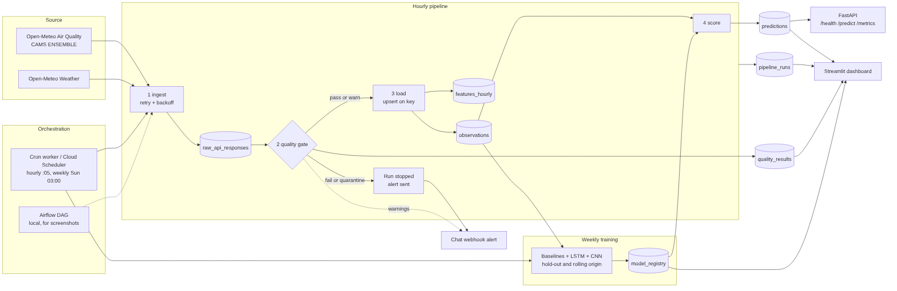

# Cloud-Native PM2.5 Forecasting Pipeline

A scheduled, containerized data pipeline. Every hour it pulls Open-Meteo air-quality and weather data, runs a quality gate, loads PostgreSQL raw / cleaned / feature layers idempotently, and scores a PyTorch forecaster. Models are trained weekly and compared honestly against strong baselines. Predictions are served by FastAPI and shown, with pipeline health, on a Streamlit dashboard. GitHub Actions tests and redeploys it on every push.

The pipeline is the headline; the neural network shows it connects to ML.

> **Data limitation.** Open-Meteo air-quality values come from the CAMS ENSEMBLE *model*, not ground sensors. This project measures how well a model forecasts another model's output. See the [model card](docs/MODEL_CARD.md).



## Quick start

```bash
cp .env.example .env            # PowerShell: copy .env.example .env
docker compose up --build
```

- API docs: http://localhost:8000/docs  ·  Dashboard: http://localhost:8501

The scheduler backfills `BACKFILL_DAYS` (90) on its first run, then fetches only what is new (plus a 48 h overlap to pick up source revisions). The trainer waits until there is at least a week of data, then retrains every 7 days.

Manual runs and recovery windows (safe to repeat; loads are idempotent):

```bash
docker compose run --rm scheduler python scripts/run_pipeline.py --start 2026-08-01 --end 2026-10-29
docker compose run --rm trainer   python scripts/train_model.py --architecture all   # or lstm / cnn
```

Optional: run the same stages as an Airflow DAG for screenshots (see [design decisions](docs/DESIGN_DECISIONS.md)):

```bash
docker compose -f docker-compose.yml -f docker-compose.airflow.yml up --build db airflow
```

## What it does, stage by stage

| Stage | What happens | Where |
|---|---|---|
| Ingest | Fetch with retries, exponential backoff + jitter, `Retry-After` honoured. Raw JSON and a SHA-256 hash are kept. | `client.py`, `pipeline.py` |
| Validate | Quality gate (below). Blocking results stop the run before any cleaned/feature write. | `quality.py` |
| Load | Drop future model-forecast hours and not-yet-published newest hours, upsert on `(location, ts, source)`, rebuild features. | `transform.py`, `repository.py` |
| Score | Active model forecasts the next 24 h; actuals are joined back as hours pass. A scoring error never undoes a clean load. | `scoring.py` |
| Train (weekly) | Baselines + LSTM + 1D-CNN, hold-out **and** rolling-origin evaluation, per-horizon metrics; best network by validation MAE becomes active. | `evaluation.py`, `training.py`, `retrain.py` |

### Quality gate

| Check | Rule (thresholds are configurable and should be calibrated) | Outcome |
|---|---|---|
| schema | Required columns present and numeric | fail |
| key_nulls | Null timestamp/PM2.5 share ≤ `MAX_NULL_SHARE` (1%) → rows dropped; more → fail | warn / fail |
| range | PM2.5 / PM10 negative or above ceiling | **quarantine** (stored raw only) |
| duplicates | Duplicate timestamps | fail |
| continuity | Largest gap > 2 h warns, > 6 h fails | warn / fail |
| freshness | Newest row older than 2 scheduling intervals | warn + alert |
| volume | Rows outside 80–110% of what the window should hold | warn + alert |

Any fail, quarantine or warning sends a chat-webhook alert (`FAILURE_WEBHOOK_URL`). Calibrate ceilings after ~2 weeks with `python scripts/calibrate_quality.py`.

## API

- `GET /health`: `ok` / `stale` / `degraded`, last successful run, freshness vs limit, active model.
- `GET /predict?horizon=24`: latest forecast for the active model (404 until trained and scored).
- `GET /metrics`: hourly-run success rate, quarantined/failed counts, bad batches caught, average rows and duration.
- `GET /models`: recent registry entries with hold-out, per-horizon and rolling-origin metrics.

## Evaluation integrity

Chronological 70/15/15 split (never shuffled between splits); a window belongs to a split by where its *target* falls; scalers are fitted on training rows only; rolling-origin folds are expanding windows. Reported: hold-out MAE/RMSE, error by forecast hour, rolling-origin mean ± std. If a baseline wins, the results say so ([results](docs/RESULTS.md)).

## Tables

| Layer | Table | Purpose |
|---|---|---|
| Raw | `raw_api_responses` | Untouched JSON, request params, hash (purged after `RAW_RETENTION_DAYS`) |
| Cleaned | `observations` | Typed hourly values, unique on `(location_id, ts_utc, source)` |
| Features | `features_hourly` | Lags, rolling statistics, calendar features |
| Serving | `predictions`, `model_registry` | Forecasts; model lineage, metrics, checkpoint |
| Ops | `pipeline_runs`, `quality_results` | Per-run metadata (status, rows, duration, failed checks), per-check evidence |

## Verification

```bash
pip install -e '.[dev]'
ruff check . && ruff format --check . && pytest -q
pre-commit install            # ruff + gitleaks secret scan
python scripts/evidence.py idempotency   # re-run a window: zero duplicates
python scripts/evidence.py bad-batch     # corrupted batch quarantined, nothing loaded
python scripts/evidence.py success-rate  # run success rate from real pipeline_runs
python scripts/quality_report.py         # docs/DATA_QUALITY_REPORT.md from recorded runs
python scripts/make_results.py           # docs/RESULTS.md from the model registry
```

## Deployment

See [docs/DEPLOYMENT.md](docs/DEPLOYMENT.md): `deploy/gcp/provision.sh` (Cloud SQL, secret, service accounts, GitHub OIDC), the opt-in `deploy-gcp.yml` workflow (tests → build → deploy API, dashboard and two Cloud Run jobs → smoke test → push-to-live timer), and `deploy/gcp/schedule.sh` (Cloud Scheduler). Cost and free-tier caveats are documented there.

## Documents

[Design decisions](docs/DESIGN_DECISIONS.md) · [Model card](docs/MODEL_CARD.md) · [Results](docs/RESULTS.md) · [Data terms & non-commercial question](docs/DATA_TERMS.md) · [Evidence checklist](docs/DEMO_CHECKLIST.md)

## Attribution

Air-quality data: [Open-Meteo Air Quality API](https://open-meteo.com/en/docs/air-quality-api), based on **CAMS ENSEMBLE** model data (Copernicus Atmosphere Monitoring Service). Weather covariates: Open-Meteo. Data is [CC BY 4.0](https://creativecommons.org/licenses/by/4.0/). The dashboard repeats this attribution.
